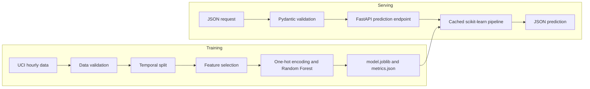

# Bike Demand Prediction

[](https://github.com/YachmenevAD/bike-demand-prediction/actions/workflows/ci.yml)

An end-to-end machine learning project for predicting hourly bike rental
demand and serving predictions through a production-oriented REST API.

## Overview

The project uses the
[UCI Bike Sharing Dataset](https://archive.ics.uci.edu/dataset/275/bike+sharing+dataset)
to predict the total number of bike rentals for a given hour.

It covers the complete ML lifecycle:

- reproducible data download and validation;
- time-based train, validation, and test splits;
- leakage-safe feature preprocessing;
- baseline and model comparison;
- temporal cross-validation and hyperparameter tuning;
- model serialization with `joblib`;
- inference through FastAPI;
- input validation with Pydantic;
- liveness and readiness health checks;
- automated tests with pytest;
- Docker packaging;
- CI with GitHub Actions;
- code quality checks with Ruff.

## Data

The dataset contains 17,379 hourly observations from 2011 and 2012.

The target is:

- `cnt` — total number of bike rentals during an hour.

The following columns are intentionally excluded from the features:

- `casual`;
- `registered`.

They directly form the target:

`cnt = casual + registered`

Using them as model inputs would cause target leakage.

The technical row identifier `instant` is also excluded.

## Evaluation protocol

The data is split chronologically rather than randomly:

| Split | Period | Rows | Purpose |
|---|---|---:|---|
| Train | 2011-01-01 — 2012-06-30 | 13,003 | Initial model training |
| Validation | 2012-07-01 — 2012-09-30 | 2,208 | Model selection and error analysis |
| Test | 2012-10-01 — 2012-12-31 | 2,168 | Final independent evaluation |

Model configurations were compared using three expanding-window temporal
cross-validation folds. Each validation fold contains approximately 30 days.

After model selection, the final model was trained on the combined train and
validation data and evaluated once on the held-out test period.

## Final results

| Model | Test MAE | Test RMSE | Test R² |
|---|---:|---:|---:|
| DummyRegressor | 156.87 | 204.43 | -0.03 |
| LinearRegression | 89.69 | 121.46 | 0.64 |
| **RandomForestRegressor** | **53.81** | **81.29** | **0.84** |

The selected Random Forest reduced MAE by approximately **65.7%** compared
with the constant-mean baseline.

Selected hyperparameters:

```text
n_estimators = 150
min_samples_leaf = 1
max_depth = None
random_state = 42
```

## Architecture



The complete scikit-learn pipeline is serialized, including both preprocessing
and the trained model. This prevents differences between feature processing
during training and inference.

## Repository structure

```text
.
├── .github/workflows/ci.yml   # Automated CI checks
├── data/                      # Data documentation and sample data
├── scripts/download_data.py   # Reproducible dataset download
├── src/
│   ├── api.py                 # FastAPI application
│   ├── data.py                # Data loading and temporal splitting
│   ├── predict.py             # Model loading and inference
│   ├── real_features.py       # Feature definitions and selection
│   ├── train.py               # Final training and serialization
│   └── train_real_models.py   # Model pipeline definitions
├── tests/test_app.py          # Unit and API tests
├── Dockerfile
├── requirements.txt           # Runtime dependencies
└── requirements-dev.txt       # Development and test dependencies
```

Downloaded data and trained model artifacts are intentionally excluded from
Git and can be reproduced using the provided scripts.

## Local setup

Requirements:

- Python 3.12;
- Git;
- Docker, optionally, for running the containerized API.

Clone the repository and create a virtual environment:

```bash
git clone https://github.com/YachmenevAD/bike-demand-prediction.git
cd bike-demand-prediction

python3 -m venv .venv
source .venv/bin/activate

python -m pip install -r requirements-dev.txt
```

Download and inspect the dataset:

```bash
python scripts/download_data.py
python -m src.inspect_real_data
```

Train the final model and generate local artifacts:

```bash
python -m src.train
```

This creates:

```text
artifacts/model.joblib
artifacts/metrics.json
```

The artifacts are not tracked by Git. The serialized model is approximately
188 MB and may take several seconds to train and load.

## Run the API locally

The trained model must exist in `artifacts/model.joblib`.

Start the API:

```bash
uvicorn src.api:app --host 127.0.0.1 --port 8000
```

The interactive OpenAPI documentation is available at:

- http://127.0.0.1:8000/docs

Health endpoints:

```bash
curl http://127.0.0.1:8000/health/live
curl http://127.0.0.1:8000/health/ready
```

Expected responses:

```json
{"status": "ok"}
```

```json
{"status": "ready"}
```

## Prediction request

Example request:

```bash
curl -X POST http://127.0.0.1:8000/predict \
  -H "Content-Type: application/json" \
  -d '{
    "season": 4,
    "mnth": 10,
    "hr": 8,
    "weekday": 2,
    "weathersit": 1,
    "yr": 1,
    "holiday": 0,
    "workingday": 1,
    "temp": 0.54,
    "atemp": 0.5152,
    "hum": 0.68,
    "windspeed": 0.1642
  }'
```

Example response:

```json
{
  "predicted_rentals": 673.61
}
```

Invalid inputs are rejected before inference. For example, `hr=99` produces
an HTTP `422 Unprocessable Entity` response.

## Run with Docker

Build the production image:

```bash
docker build -t bike-demand-api:local .
```

Run the container and mount the trained model as read-only:

```bash
docker run --rm -d \
  --name bike-demand-api \
  -p 8000:8000 \
  --mount "type=bind,source=$(pwd)/artifacts,target=/app/artifacts,readonly" \
  bike-demand-api:local
```

Check the container state:

```bash
docker inspect \
  --format '{{.State.Health.Status}}' \
  bike-demand-api
```

Stop the container:

```bash
docker stop bike-demand-api
```

## Development checks

Run the same checks that are executed in CI:

```bash
ruff check .
ruff format --check .
pytest -v
```

GitHub Actions additionally verifies that the production Docker image can be
built and does not contain development-only tools such as pytest.

## Limitations

- The model was trained on historical data from 2011–2012 and may not
  generalize to current bike-sharing systems.
- The evaluation covers one city and one data source.
- Weather features are already normalized by the dataset and require the same
  preprocessing for real production inputs.
- The Random Forest cannot reliably extrapolate demand beyond patterns
  observed during training.
- The API returns a point prediction without an uncertainty interval.
- The model artifact is relatively large, approximately 188 MB.
- No production monitoring, drift detection, authentication, or automated
  model retraining is implemented yet.

## License and data source

The dataset is provided by the
[UCI Machine Learning Repository](https://archive.ics.uci.edu/dataset/275/bike+sharing+dataset)
under the CC BY 4.0 license.

Dataset DOI: https://doi.org/10.24432/C5W894