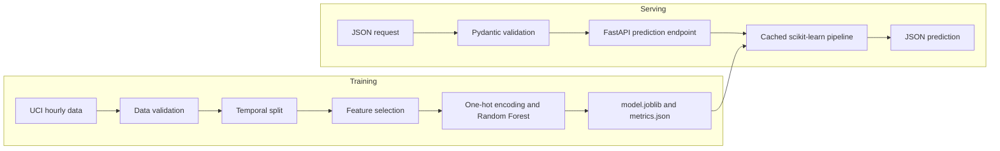

# Bike Demand Prediction

[](https://github.com/YachmenevAD/bike-demand-prediction/actions/workflows/ci.yml)

An end-to-end machine learning project for predicting hourly bike rental
demand and serving predictions through a production-oriented REST API.

## Overview

The project uses the
[UCI Bike Sharing Dataset](https://archive.ics.uci.edu/dataset/275/bike+sharing+dataset)
to predict the total number of bike rentals for a given hour.

It covers the complete ML lifecycle:

- reproducible data download and validation;
- time-based train, validation, and test splits;
- leakage-safe feature preprocessing;
- baseline and model comparison;
- temporal cross-validation and hyperparameter tuning;
- model serialization with `joblib`;
- inference through FastAPI;
- input validation with Pydantic;
- liveness and readiness health checks;
- automated tests with pytest;
- Docker packaging;
- CI with GitHub Actions;
- code quality checks with Ruff.

## Data

The dataset contains 17,379 hourly observations from 2011 and 2012.

The target is:

- `cnt` — total number of bike rentals during an hour.

The following columns are intentionally excluded from the features:

- `casual`;
- `registered`.

They directly form the target:

`cnt = casual + registered`

Using them as model inputs would cause target leakage.

The technical row identifier `instant` is also excluded.

## Evaluation protocol

The data is split chronologically rather than randomly:

| Split | Period | Rows | Purpose |
|---|---|---:|---|
| Train | 2011-01-01 — 2012-06-30 | 13,003 | Initial model training |
| Validation | 2012-07-01 — 2012-09-30 | 2,208 | Model selection and error analysis |
| Test | 2012-10-01 — 2012-12-31 | 2,168 | Final independent evaluation |

Model configurations were compared using three expanding-window temporal
cross-validation folds. Each validation fold contains approximately 30 days.

After model selection, the final model was trained on the combined train and
validation data and evaluated once on the held-out test period.

## Final results

| Model | Test MAE | Test RMSE | Test R² |
|---|---:|---:|---:|
| DummyRegressor | 156.87 | 204.43 | -0.03 |
| LinearRegression | 89.69 | 121.46 | 0.64 |
| **RandomForestRegressor** | **53.81** | **81.29** | **0.84** |

The selected Random Forest reduced MAE by approximately **65.7%** compared
with the constant-mean baseline.

Selected hyperparameters:

```text
n_estimators = 150
min_samples_leaf = 1
max_depth = None
random_state = 42
```

## Architecture



The complete scikit-learn pipeline is serialized, including both preprocessing
and the trained model. This prevents differences between feature processing
during training and inference.